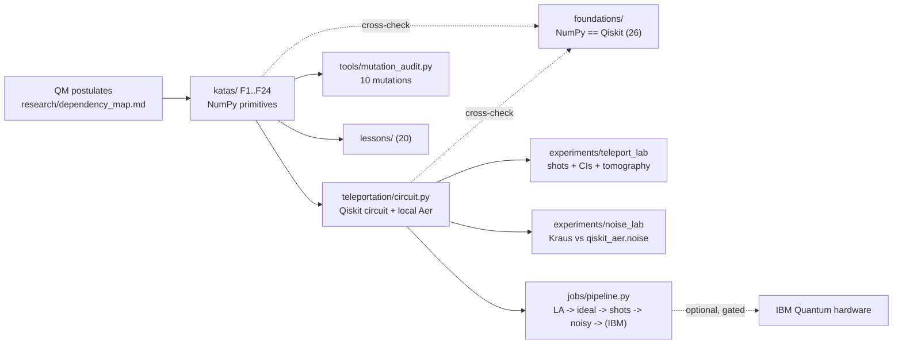

# Quantum Foundations Lab

An **executable quantum-computing foundations laboratory**, built by
reverse-engineering the 3-qubit quantum-teleportation protocol down to its
quantum-mechanical postulates and rebuilding it so that the **implementation, the
mathematics, the tests, and the physical interpretation cross-check one another**.

**650 automated tests pass**, entirely offline, in about 20 seconds.

## What this is

- A dependency graph from QM postulates → 24 primitives (`F1` Hilbert space …
  `F24` the teleportation identity) → the assembled circuit, each step with an
  explicit NumPy implementation and property-based tests.
- Independent **NumPy ↔ Qiskit cross-validation** of 26 concepts.
- A measured **teleportation experiment** and a reproducible **noise laboratory**.
- A **20-lesson guided path** with live checks.
- An **optional, safety-gated** IBM Quantum execution path.

## What this is NOT

- **Not** a quantum-advantage or quantum-supremacy claim.
- **Not** quantum-computing research evidence.
- **Not** evidence of hardware experimentation — `docs/hardware_runs.md` is an
  empty template; no real-device data is included in this release.
- **Not** a Qiskit tutorial clone — the point is the cross-checking, the
  adversarial audit, and the postulate-up derivation, not the API.

---

## 1. Mathematical foundations

`katas/NN_*.py` — one primitive per file, from `research/dependency_map.md`:

`F1` complex Hilbert space · `F9` multi-qubit basis & endianness · `F10`
projectors · `F11` Pauli operators · `F12` the Pauli group · `F13` Hadamard ·
`F14` controlled-U / CNOT · `F15` Born rule · `F16` projective measurement &
expectation values · `F17` partial measurement · `F18` density operators · `F19`
partial trace · `F20` entanglement entropy · `F21`/`F22` Bell states & the Bell
pair · `F23` classical control / deferred measurement · `F24` the teleportation
identity · `T` the assembled circuit.

Each carries a property test asserting a real invariant (unitarity, the spectral
theorem, `ΣP=I`, group closure, `S(ρ_A)=S(ρ_B)`, `tr(ρ_A M)=tr(ρ_AB (M⊗I))`, …).

## 2. NumPy ↔ Qiskit cross-validation

`foundations/crosscheck.py` computes 26 concepts **twice** — hand-written linear
algebra **and** `qiskit.quantum_info` — and asserts agreement, plus a checked
physical prediction for each. The one bridge between the project's big-endian
convention and Qiskit's little-endian (`reverse_qubit_order`) is explicit and
itself tested.

```
python -m foundations        # prints the 26-row table
```

## 3. Teleportation experiment

`experiments/teleport_lab.py` teleports `|0⟩, |1⟩, |+⟩, |−⟩, |+i⟩, |−i⟩` and
reproducible random states. For each it reports, **never conflated**:

- `F_ideal` — exact fidelity from the statevector
- `F_emp` — a 3-basis-tomography estimate from finite shots, with a 95% Wilson CI
- the measured Bloch vector vs the true one
- a χ² test that Alice's 2-bit outcome is uniform (no-signalling)

```
python -m experiments.teleport_lab --shots 8192
```

## 4. Noise laboratory

`experiments/noise_lab.py` + `experiments/channels.py`: six single-qubit channels
(bit / phase / bit-phase flip, depolarizing, amplitude damping, phase damping) as
explicit Kraus operators, **each cross-checked against `qiskit_aer.noise`**, plus
a readout-error experiment and a teleportation-under-gate-noise degradation curve.
Metrics: fidelity, purity, `⟨X⟩⟨Y⟩⟨Z⟩`, measurement distributions. Fully seeded.

```
python -m experiments.noise_lab
```

## 5. Lesson runner

```
python -m lessons.run --list
python -m lessons.run --lesson 4 --run     # execute the lesson's check live
python -m lessons.run --next               # advance when you've done the challenge
```

20 lessons, `F1 → F24 → T → labs`, each with concept · why · mathematics · worked
example · code · prediction · **actual result (executed)** · interpretation ·
common misconception · **challenge** (solutions hidden unless `--reveal`).
See `docs/progression.md`.

## 6. Test count

| | tests |
|---|---:|
| primitives + integration (`F1..F24`, `T`) | 356 |
| foundations cross-checks + weakness fixes | 160 |
| experiment labs (teleport / noise / pipeline) | 91 |
| lesson content | 43 |
| **total** | **650** |

`pytest` runs all of it offline in ~20 s. The adversarial audit
(`tools/mutation_audit.py`) introduces 10 deliberately-wrong implementations:
**9 are caught**, and the 1 that is physically invisible (a global phase) is
**correctly not caught**. See `AUDIT.md`.

## 7. IBM Quantum hardware path (optional)

Stages 1–4 of `jobs/pipeline.py` (explicit linear algebra → ideal simulation →
shot simulation → noisy simulation) run with **no credentials**. Stage 5 is IBM
hardware and is:

- **credential-gated** — `jobs/preflight.py` validates config and submits nothing;
- **spend-gated** — submission requires `--yes-spend-credits` or retyping the
  backend name interactively. Credentials being present is never permission to run.

No hardware has been executed for this release. `docs/hardware_runs.md` shows the
record schema and an empty log.

## 8. Safety & reproducibility design

- Works **completely offline** except explicit IBM-hardware operations (verified
  from a clean clone into a fresh virtualenv).
- Dependencies pinned: `requirements.lock.txt` (exact, what CI installs) +
  `requirements.txt` (ranges). Python 3.12.
- Every experiment record is tagged `SIMULATED` or `HARDWARE`. Frequencies always
  carry a confidence interval; they are never equated with exact probabilities.
- Secrets are `.gitignore`d aggressively (`.qiskit/`, `*token*`, `.env`, …) and
  no credential or generated job artifact is tracked.
- Phase-insensitive comparisons use fidelity / `|⟨a|b⟩|`, never raw `allclose`.

---

## Quickstart

Requires **Python 3.12** and `git`.

```bash
git clone https://github.com/<you>/quantum-foundations-lab
cd quantum-foundations-lab

python3 -m venv .venv && . .venv/bin/activate
pip install -r requirements.lock.txt

pytest                                            # 650 tests, ~20 s, offline
python -m lessons.run                             # start learning
python -m experiments.teleport_lab --shots 4096   # first experiment
```

or `make install && make test`.

## Architecture



## Layout

```
research/dependency_map.md   the reverse-engineered dependency graph
katas/NN_*.py                one primitive each (F1..F24)  + tests/test_NN_*.py
foundations/                 NumPy <-> Qiskit cross-checks (26 concepts)
teleportation/circuit.py     the assembled Qiskit circuit
experiments/                 teleport_lab, noise_lab, channels, stats
jobs/                        pipeline (offline), preflight, submit, compare  (IBM path)
lessons/                     guided learning content + runner
tools/mutation_audit.py      adversarial audit
docs/                        changelog, progression, hardware_runs (empty)
AUDIT.md                     baseline audit: test classification + mutation results
```
